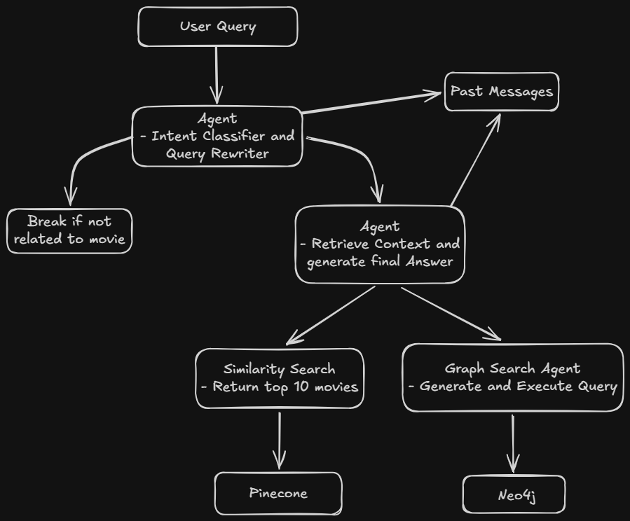

# MovieKnowledge

A GraphRAG project that answers movie questions. It combines a **Neo4j** knowledge graph with **Pinecone** vector search, uses **Groq** for the language model, and ships with a React web app for asking questions.

Example questions:

- Which movies did Tom Hanks act in?
- What themes does Inception explore?
- Which movies won Best Picture in 2020?

## Architecture



## Project structure

```
MovieKnowledge/
├── client/                     React + Vite + Tailwind CSS web app
│   ├── public/
│   ├── src/
│   ├── .env.example
│   ├── eslint.config.js
│   ├── index.html
│   ├── package.json
│   └── vite.config.js
├── server/                     Node.js API and GraphRAG pipeline
│   ├── chatbot/                Question answering logic
│   ├── config/
│   │   └── config.js           Neo4j, Pinecone and Groq setup
│   ├── data_indexing/
│   │   ├── data/               Source movie data
│   │   ├── parsers/            Extract and structure the raw data
│   │   ├── uploaders/          Load data into Neo4j and Pinecone
│   │   ├── config_structure.js
│   │   └── index.js            Indexing entry point
│   ├── docs/                   Architecture diagram
│   ├── .env.example
│   ├── index.js                Server entry point
│   └── package.json
└── Readme.md
```

## Prerequisites

- Node.js 18 or later
- A [Groq](https://console.groq.com) API key (two keys are used)
- A [Pinecone](https://www.pinecone.io) account and index
- A [Neo4j](https://neo4j.com) database (Aura or self-hosted)

## Setup

### 1. Clone the repository

```bash
git clone <your-repo-url>
cd MovieKnowledge
```

### 2. Set up the server

```bash
cd server
npm install
```

Copy the example file and fill in your credentials:

```bash
cp .env.example .env
```

```dotenv
GROQ_API_KEY1="your_groq_api_key"
GROQ_API_KEY2="your_groq_api_key"

PINECONE_API_KEY="your_pinecone_api_key"
PINECONE_INDEX="your_pinecone_index"

NEO4J_URI="your_neo4j_uri"
NEO4J_USERNAME="your_neo4j_username"
NEO4J_PASSWORD="your_neo4j_password"

PORT="port_on_which_server_will_run"
CLIENT_URL="url_on_which_cient_is_running"
```

### 3. Index the data

Run this once to extract the movie data and load it into Neo4j and Pinecone. It is slow, so be patient.

```bash
npm run data_indexing
```

### 4. Set up the client

In a new terminal:

```bash
cd client
npm install
```

Copy the example file and point it at the server:

```bash
cp .env.example .env
```

```dotenv
VITE_API_URL="http://localhost:5000"
```

Use the port your server actually listens on, and make sure the variable name matches the one read in `client/src/api/api.js`.

## Run the app

Start the server and the client in two separate terminals.

**Server**

```bash
cd server
npm run dev
```

**Client**

```bash
cd client
npm run dev
```

Open the URL Vite prints, usually `http://localhost:5173`.

## Scripts

| Location | Command | What it does |
| --- | --- | --- |
| `server` | `npm run dev` | Starts the API server |
| `server` | `npm run data_indexing` | Extracts and indexes movie data |
| `client` | `npm run dev` | Starts the Vite dev server |

## Tech stack

- **Client:** React, Tailwind CSS
- **Server:** Express
- **Data and AI:** Neo4j, Pinecone, Groq
